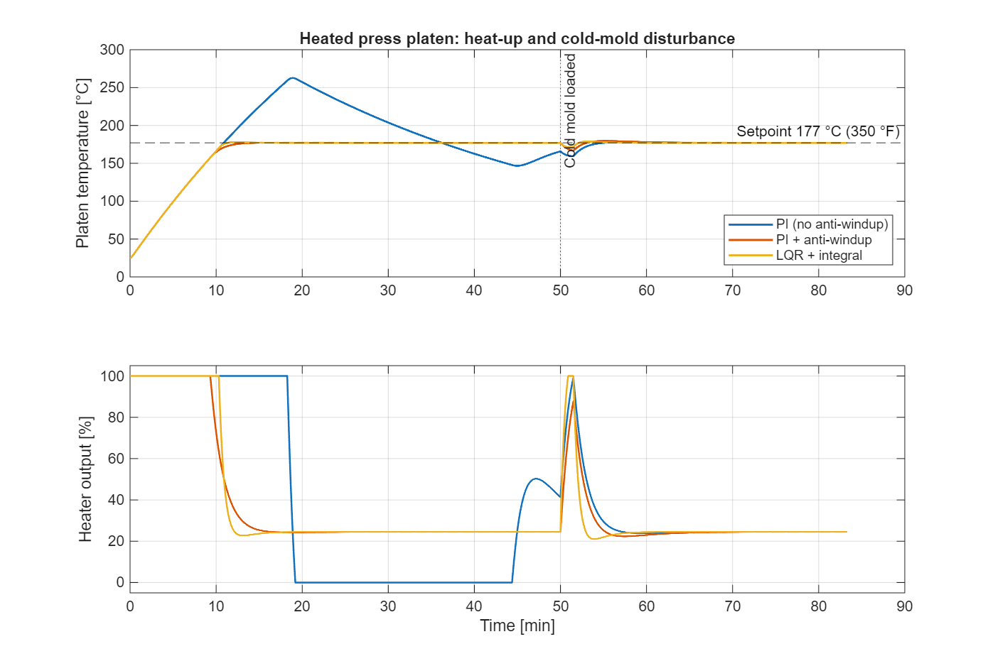

# Digital Temperature Control of a Heated Press Platen

Rubber parts are cured in heated presses at about 350 °F (177 °C). If the platen overshoots, parts burn. If it drifts low or recovers slowly after a cold mold is loaded, parts come out under-cured. Either way, that's scrap.

This project models a heated platen, designs a digital PI controller with anti-windup, compares it with an LQR controller, and runs the same PI algorithm on a PLC (CODESYS) with a simulated plant.

**Courses applied:** Modern Control Systems (state space, LQR), Digital Control Systems (ZOH discretization, sample time, discrete PI), Engineering Analysis (thermal modeling).



---

## 1. Plant model

Two lumped thermal masses: the heater cartridges and the steel platen.

```
Ch · dTh/dt = Pmax·u − (Th − Tp)/Rhp
Cp · dTp/dt = (Th − Tp)/Rhp − (Tp − Ta)/Rpa + w
```

| Symbol | Meaning | Value |
|---|---|---|
| Ch | Heater thermal capacity | 800 J/K |
| Cp | Platen thermal capacity (~28 kg steel) | 14,000 J/K |
| Rhp | Heater → platen thermal resistance | 0.01 K/W |
| Rpa | Platen → ambient thermal resistance | 0.155 K/W |
| Pmax | Heater power at 100 % | 4,000 W |
| u | Heater command (SSR duty) | 0 – 1 |
| w | Disturbance heat (cold mold) | −3,000 W for 90 s |

The model has a fast heater pole (τ ≈ 7.6 s) and a slow platen pole (τ ≈ 2,294 s, about 38 min), with a DC gain of 620 K per unit of heater output. It is discretized with an exact zero-order hold at Ts = 1 s (`expm`, so no toolbox is needed).

Values are generic, chosen to behave like a typical electrically heated platen. They are not company data.

## 2. Controllers

| Controller | Design method | Notes |
|---|---|---|
| PI, no anti-windup | SIMC tuning on a FOPDT approximation (τc = 60 s, θ = 12 s) | Kp = 0.0514 /°C, Ti = 288 s |
| PI + anti-windup | Same gains, conditional integration (clamping) | The algorithm used on the PLC |
| LQR + integral | Discrete LQR on the augmented state [Th, Tp, ∫e] | Q = diag(0, 10, 1e-3), R = 1e3, K = [0.0065 0.1290 0.00098]. Assumes Th is measured; an observer is a planned extension |

## 3. Results

Test: heat-up from 25 °C to 177 °C, then a cold mold is loaded at t = 50 min.

| Controller | Overshoot | Settling (±1 °C) | Mold dip | Recovery | Energy |
|---|---|---|---|---|---|
| PI, no anti-windup | 85.7 °C | > 50 min | – | – | 2.06 kWh |
| PI + anti-windup | 0.26 °C | 12.8 min | 10.3 °C | 10.1 min | 1.98 kWh |
| LQR + integral | 0.86 °C | 11.0 min | 5.5 °C | 4.6 min | 1.98 kWh |

Results from `matlab/run_comparison.m` (MATLAB). Dip and recovery are not given for the no-anti-windup case because it was still recovering from its overshoot when the mold was loaded.

**Takeaway:** without anti-windup the platen reaches about 263 °C, enough to burn parts. Clamping anti-windup cuts the overshoot from 85.7 °C to 0.26 °C with no slower heat-up. LQR roughly halves the dip from a cold mold because it also uses the heater temperature.

**Design choice:** PI with tc = 60 s and anti-windup is the recommended controller. It had the lowest heater jitter under sensor noise (2.6 % vs 16 % for aggressive LQR) and was the only one stable with 60 s of sensor delay. See `docs/test_log.md`.

## 4. Experiments

Full tables and plots are in [`docs/test_log.md`](docs/test_log.md).

| # | Experiment | Finding |
|---|---|---|
| 1 | PI tuning speed (tc = 30 / 60 / 120 s) | Faster tuning halves the cold-mold dip, but makes windup worse without anti-windup |
| 2 | PI sample time (1–60 s) | No visible change up to Ts = 10 s; a 60 s task raises the dip about 47 % |
| 3 | LQR effort weight R (10 – 100,000) | R sets aggressiveness: dip from 2.1 °C to 13.4 °C |
| 4 | Robustness: ±30 % plant error, noise, sensor delay | PI tc = 60 is quietest and the only one stable at 60 s sensor delay |


## 5. How to run

**MATLAB** (base MATLAB, R2018b or newer; no toolboxes needed)

```matlab
cd matlab
run_comparison
```

This prints the results table and saves `media/controller_comparison.png`.

**CODESYS** (free, V3.5)

1. Create a Standard Project with *CODESYS Control Win V3* (the soft PLC).
2. Add the three function blocks and `PLC_PRG` from `plc/` (one POU each, Structured Text).
3. Set the MainTask to cyclic, 100 ms.
4. Start the soft PLC (*Gateway* + *PLC* tray icons), log in, and run.
5. Use Trace to plot `fbPlant.rTp`, `rDuty` and `rSetpoint`; set `xStart`, then `xLoadColdMold`.
6. Set `fbPI.xAntiWindup := FALSE` to show windup on the PLC.

## 6. Repository layout

```
matlab/   model, PI and LQR simulations, comparison script
plc/      CODESYS Structured Text: PI + anti-windup, plant model, SSR output, main program
docs/     derivations, tuning notes, test log
media/    plots, HMI screenshots, demo video link
```

## 7. Planned extensions

- Luenberger observer or Kalman filter to estimate heater temperature from the platen sensor only
- Upper + lower platen (two coupled loops)
- HMI screens in CODESYS Visualization: trend, setpoint, alarms
- Hardware test on Arduino + power resistor + thermistor
